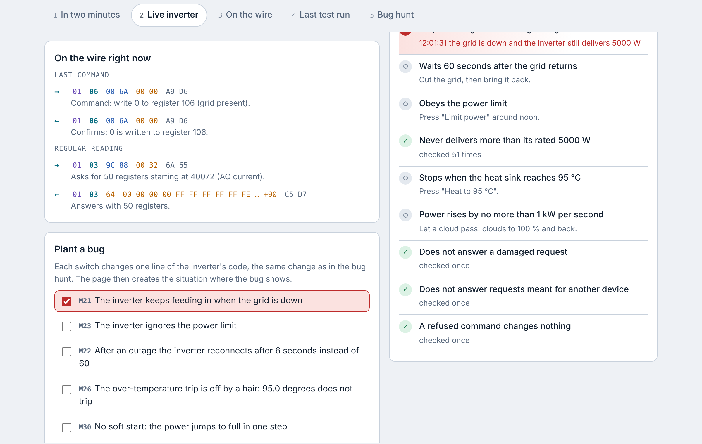

# solar-inverter-testing

[](https://github.com/NailKarimov/solar-inverter-testing/actions/workflows/tests.yml)
[](https://nailkarimov.github.io/solar-inverter-testing/index.html)
[](https://github.com/NailKarimov/solar-inverter-testing/releases)
[](https://codespaces.new/NailKarimov/solar-inverter-testing?quickstart=1)

### ▶ Open online

| Page                                                                    | What it is                                                              |
| ----------------------------------------------------------------------- | ----------------------------------------------------------------------- |
| **[The project in two minutes](https://nailkarimov.github.io/solar-inverter-testing/solar-inverter.html#tour)**           | for a reader with no technical background: pictures and plain sentences |
| **[Live inverter](https://nailkarimov.github.io/solar-inverter-testing/solar-inverter.html#live)**                        | move the sun, cut the grid, plant a bug and watch a check turn red      |
| [On the wire](https://nailkarimov.github.io/solar-inverter-testing/solar-inverter.html#wire)                              | one question and one answer taken apart byte by byte                    |
| [Last test run, replayed](https://nailkarimov.github.io/solar-inverter-testing/solar-inverter.html#replay)                | every test as one sentence, with the real bytes it exchanged            |
| [Bug hunt](https://nailkarimov.github.io/solar-inverter-testing/solar-inverter.html#bugs)                                 | 38 planted bugs and the tests that caught each                          |
| [Allure test report](https://nailkarimov.github.io/solar-inverter-testing/index.html)                                     | latest CI run on three links                                            |

Click these links: opening an `.html` file in the file list shows its source code, GitHub does not run it.

[](https://nailkarimov.github.io/solar-inverter-testing/solar-inverter.html#live)

A simulated 5 kW solar inverter that speaks **Modbus RTU** and **Modbus TCP** with a **SunSpec** register map, and
the **Python + pytest** suite that proves it behaves: on the wire, as a SunSpec device, through a sunny day, and
when the grid fails or it overheats. Three independent clients ask the questions: hand-built frames, pymodbus and
the official SunSpec client.

The project is built to be shown to people who do not read code. Every test is one plain sentence, and one page
turns the run into pictures: [open it](https://nailkarimov.github.io/solar-inverter-testing/solar-inverter.html).

## At a glance

| Row                | Content                                                                                                                                                         |
| ------------------ | --------------------------------------------------------------------------------------------------------------------------------------------------------------- |
| System under test  | Own simulator of a single-phase PV inverter (`src/inverter_lab`): physical model, SunSpec models 1, 101, 120, 123, Modbus RTU and TCP servers                  |
| Language and tools | Python 3.12; pytest, Hypothesis, pymodbus, pysunspec2, pyserial, socat, Allure, ruff, mypy; Playwright and Node.js for the visual page                          |
| Types of testing   | Protocol conformance, interoperability, functional behaviour, safety functions, negative and boundary, property-based fuzzing, robustness, hardware-in-the-loop |
| Tests              | 359 on three links (309 in memory, 243 over virtual serial ports, 200 over TCP) + 18 browser tests of the visual page + 3 bench-only                            |
| Test quality       | 38/38 planted bugs caught (`scripts/mutants.py`); the JavaScript twin of the simulator gives 2572 identical answers                                             |
| Reports            | [Allure](https://nailkarimov.github.io/solar-inverter-testing/index.html) · [visual page](https://nailkarimov.github.io/solar-inverter-testing/solar-inverter.html) · [mutation table](https://nailkarimov.github.io/solar-inverter-testing/mutants/result.md)                                                         |

## What is tested

| Suite                                          | Tool                    | What it proves                                                                                                    |
| ---------------------------------------------- | ----------------------- | ----------------------------------------------------------------------------------------------------------------- |
| `test_crc`, `test_frames`                      | pytest, Hypothesis      | CRC-16 and frames match the published examples; any single flipped bit and any burst up to 16 bits is detected    |
| `test_protocol_rtu`                            | own client, raw bytes   | Answers, exceptions 01/02/03, silence for a foreign address, a broadcast and a damaged frame; recovery after noise |
| `test_protocol_tcp`                            | own client, raw sockets | MBAP header, pipelined requests, slow and broken connections, several clients at once                             |
| `test_sunspec_codec`, `test_sunspec_map`       | pytest, pysunspec2 data | The hand-written map equals the official SunSpec model definitions point by point                                 |
| `test_interop_pymodbus`                        | pymodbus                | A standard Modbus library reads, writes and sees the same refusals                                                |
| `test_interop_sunspec`                         | pysunspec2              | The official SunSpec client discovers the device and reads the same values as the project's client                |
| `test_inverter_day`                            | simulated clock         | Power follows the datasheet curve; clipping at 5 kW; start-up, soft start, energy counter, temperatures           |
| `test_grid_safety`                             | simulated clock         | Anti-islanding within 1 s, 60 s reconnect delay, over-temperature trip at exactly 95.0 °C and reset at 75.0 °C    |
| `test_power_limit`                             | SunSpec model 123       | Power limit, ramp time, revert timeout, disconnect and reconnect commands                                         |
| `test_register_access`                         | own client              | Read-only points refuse writes; a write with one bad value changes nothing                                        |
| `test_robustness`, `test_client_noise`         | Hypothesis, noisy link  | Random bytes never stop the device; the client never turns a damaged answer into data                             |
| `test_bench`                                   | two USB-RS485 adapters  | 1000 polls over a real RS-485 line without a lost frame (runs at home, skipped in CI)                             |
| `test_pages`, `site/test/twin.test.mjs`        | Playwright, Node.js     | The visual page works in a browser; its JavaScript twin answers byte for byte like the Python simulator           |

## Findings

No defects are open: the system under test is the project's own simulator, and it is corrected when a test finds a
fault. What the tests found on the way is in [`docs/test-report.md`](docs/test-report.md), section 3. Bug reports
for third-party systems of the portfolio are on the [QA defects board](https://github.com/users/NailKarimov/projects/2).

## Running it

No local setup: the **Open in GitHub Codespaces** badge starts a browser VS Code with Python, Node, socat and
Chromium installed; then `pytest` works in the terminal.

Requirements: Python 3.12+, socat for the serial-port run, Node.js 20+ and Playwright for the visual page.

```bash
python3 -m venv .venv && . .venv/bin/activate
pip install -e ".[dev,pages]"

pytest -m "not pages"                     # in memory
LINK=socat pytest -m "not pages"          # over two virtual serial ports
LINK=tcp pytest -m "not pages"            # over Modbus TCP
python scripts/build_pages.py --check     # docs/solar-inverter.html from the evidence of these runs
node site/test/twin.test.mjs              # the JavaScript twin against the Python simulator
python -m playwright install chromium && pytest -m pages
python scripts/mutants.py                 # 38 planted bugs (about 15 minutes); one bug: python scripts/mutants.py M21

python -m inverter_lab serve --tcp 5020 --time-scale 600 --start 04:00   # a day in 2.5 minutes
python -m inverter_lab watch tcp://127.0.0.1:5020

ruff check . && ruff format --check . && mypy src tests scripts
```

On a real RS-485 line with two USB adapters: [`bench/README.md`](bench/README.md).

## Project structure

```text
src/inverter_lab/   CRC, PDU, RTU and MBAP codecs, SunSpec map, inverter model, device, servers, client, CLI
tests/              one file per suite; conftest.py picks the link from LINK and records every frame
tests/support/      simulator control, evidence recorder, noisy link, datasheet formulas, official SunSpec models
scripts/            mutants.py (mutation check), build_pages.py (visual page and twin conversations)
site/               source of the visual page: views, styles, the JavaScript twin, Russian texts
docs/               the built page, test plan, test report, guide, screenshots
bench/              wiring and commands for two USB-RS485 adapters
evidence/           mutants.json; run-<link>.json is written by every test run
```

## Design decisions

- **Three clients, one device.** The project's own client can send broken frames; pymodbus and pysunspec2 were
  written by other people. A mistake shared by the simulator and its own client is caught by the other two.
- **The map is checked against the standard, not against itself.** `test_sunspec_map` compares every point with
  the JSON model definitions shipped with pysunspec2.
- **The datasheet is typed in twice.** `tests/support/datasheet.py` restates the formulas and limits, so a changed
  constant in the simulator makes the two disagree.
- **Time moves only on command.** The simulator has no real clock in tests: a write to register 103 lets seconds
  pass. A whole day runs in milliseconds and every run sees the same day.
- **The test bench is part of the register map.** Time, clouds, grid and temperature are set through Modbus
  registers 100 to 115, so the same tests run in memory, through a port, and on a cable to another machine.
- **Every test is a sentence.** A test without a one-sentence docstring fails collection. The sentence is the title
  in Allure and on the visual page, in English and in Russian.
- **The page shows the real run.** Tests record every frame; `build_pages.py` puts them into the page. The live
  model in the page is a JavaScript twin, replayed against 2572 answers recorded from the Python simulator.

## CI

`.github/workflows/tests.yml` runs on push, pull request, nightly and on demand: lint and type check, the suite on
three links, the build of the visual page from that run, the twin check, the browser tests. The Allure report with
history, the visual page and the mutation table go to GitHub Pages. The mutation job runs on demand (a checkbox in
"Run workflow").

Releases: committing `.github/releases/<tag>.md` runs the Release workflow, which creates the tag and the GitHub
release with that file as its notes.

## Documentation

| Document                                                   | What it is                                                             |
| ---------------------------------------------------------- | ---------------------------------------------------------------------- |
| [`docs/test-plan.md`](docs/test-plan.md)                   | test plan (ISO/IEC/IEEE 29119-3)                                       |
| [`docs/test-report.md`](docs/test-report.md)               | test summary report: latest results, findings, deviations              |
| [`docs/solar-inverter.md`](docs/solar-inverter.md)         | guide: Modbus, SunSpec, the simulator, the three links, the visual page |
| [`docs/solar-inverter.html`](https://nailkarimov.github.io/solar-inverter-testing/solar-inverter.html)       | the same as an interactive page with five views (EN/RU)                |
| [`bench/README.md`](bench/README.md)                       | the bench: two USB-RS485 adapters, wiring, commands                    |
| [`mutants-result.md`](mutants-result.md)                   | the mutation table of the latest full run                              |

## Part of a portfolio

One of the test automation projects by [Nail Karimov](https://github.com/NailKarimov):
[all projects](https://github.com/NailKarimov) ·
[testing map](https://nailkarimov.github.io/api-test-automation/testing-map.html) ·
[toolbox](https://nailkarimov.github.io/api-test-automation/toolbox.html).
